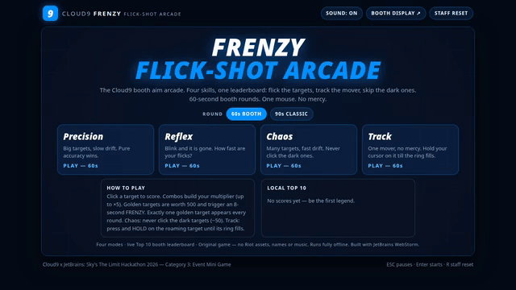

# Frenzy — Cloud9 Flick-Shot Arcade



**Frenzy** is a mouse-only flick-shot arcade game for Cloud9 event booths —
built for the **Cloud9 x JetBrains: Sky's The Limit Hackathon 2026,
Category 3 (Event Mini Game)**. Four modes train four different slices of
aim skill — but the headline is **Track**: one roaming mover you hold your
cursor on until its ring fills. It trains tracking, not just flicking. A
second-monitor booth display turns every round into a crowd event.

> The Cloud9 booth aim arcade. Flick the targets, track the mover, skip the
> dark ones. 60 seconds. One mouse. No mercy.

**Play it now:** https://farhanstar89-glitch.github.io/cloud9-flick-shot-frenzy/
(open `index.html` — no install, no build step, no account, works fully offline)

## Built & inspected in WebStorm

Built and inspected in **JetBrains WebStorm 2026.3** (build WS-263.7307.202):
headless inspection reports **0 errors across 199 findings** (38 warnings,
146 weak warnings, 7 style suggestions — all non-blocking). The full report
is in [`docs/WEBSTORM-INSPECTION.md`](docs/WEBSTORM-INSPECTION.md) and the
`.idea/` project files are committed as evidence.

## How to play

- **Pick a mode** — Precision, Reflex, Chaos, or Track — then play.
  Rounds are **60 seconds** by default (the booth standard); a 90-second
  classic round is one tap away on the menu.
- **Combos:** consecutive hits without a miss raise your multiplier, up to ×5.
- **Golden target:** exactly one appears every round, at a random moment.
  Hit it for 500 points and trigger an 8-second **FRENZY** (double points).
- **Chaos mode:** dark targets with a red ✕ are decoys — clicking one costs
  50 points and breaks your combo.
- **Track mode:** one target roams the arena — press and HOLD your mouse on
  it until its ring fills to capture it. Slip off and the ring drains.
- **Score screen:** final score, accuracy, best combo, average reaction time
  in ms, on-target time (Track), and an S/A/B/C rank. Enter your tag to save
  it on the local Top 10 leaderboard.

| Mode | The idea | Who it's for |
|---|---|---|
| **Precision** | Big targets, slow drift, shrinking rings. Score rewards dead-center hits. | First-time players, warm-up |
| **Reflex** | Targets vanish in under a second. Score rewards fast flicks. | Reaction-time bragging rights |
| **Chaos** | Many fast drifting targets + decoys. Don't click the dark ones. | The booth crowd, rematches |
| **Track** | One roaming mover — hold your cursor on it till the ring fills. A genuinely different skill: tracking, not flicking. | Aim-trainer purists, the leaderboard grinders |

A round is 60 seconds plus a 3-2-1 countdown — a full session (menu →
play → score) is under 2 minutes, so the booth line keeps moving.
(90s classic rounds are available from the menu for players who want the
long game.)

## Booth setup

Two screens, one machine, zero network needed:

1. **Player screen:** open `index.html` (or the GitHub Pages link above).
2. **Leaderboard screen:** open `booth.html` on the second monitor.
   It shows the live Top 10 (overall + per-mode tabs auto-cycling every 8s),
   and works with no Wi-Fi.

Booth behaviour is built in:

- **Clean reset:** the score screen auto-returns to the attract screen
  after 15 s of inactivity, ready for the next player.
- **Staff reset:** a STAFF RESET button (top bar) or the `R` key clears the
  local leaderboard and returns to the menu (guarded by a confirm dialog,
  so a stray tap can't nuke it).
- **Live leaderboard:** the booth display updates the moment a score is
  saved — via a `BroadcastChannel` message plus the native `storage` event
  (a 2 s poll is only the fallback). No refresh, no reload, no Wi-Fi.
- **Attract mode:** after 30 s idle on the menu, a pulsing "TAP TO PLAY"
  overlay appears over the animated demo targets.
- **Auto-pause:** the game pauses itself if the window loses focus.
- **Local leaderboard:** scores live in `localStorage` on the booth machine —
  nothing leaves the device, nothing needs an account.

## Run it

No build step, no dependencies, no server required:

```bash
# Option A — just open it
open index.html        # or double-click it in your file manager

# Option B — serve it locally (any static server works)
python3 -m http.server 8000
# then visit http://localhost:8000/
```

Works in any modern desktop browser. Mouse only (touch works too via
Pointer Events). Sound is synthesized with WebAudio — no audio files — and
can be muted from the top bar.

## Files

| File | What it is |
|---|---|
| `index.html` | Game shell: menu, HUD, score screen, attract overlay |
| `style.css` | Cloud9 blue / white / dark navy theme (system fonts only, offline-safe) |
| `game.js` | All game logic: spawning, scoring, combos, frenzy, sounds, states |
| `leaderboard.js` | Local leaderboard storage (shared by game + booth view) |
| `booth.html` / `booth.js` | Second-monitor live top-10 display |
| `tests/smoke_test.py` | Playwright smoke test: full loop, Track capture, Top 10, staff reset, live booth — zero console errors |
| `tests/bot_playtest.py` | Scripted bot playtests (4 skill levels × 4 modes) |
| `docs/PLAYTEST-REPORT-FULL90.md` | Bot results from full 90-second rounds |
| `docs/gameplay.gif` | 10 s gameplay loop (menu → golden target → FRENZY) for the README |
| `docs/JUDGE-PATH-TEST.md` | 30-second judge-path test: clean browser, time-to-menu, console errors |
| `docs/WEBSTORM-INSPECTION.md` | WebStorm headless inspection report (0 errors, 199 findings) |
| `AI_SHOWCASE.md` | AI-powered workflow story (bonus prize entry) |
| `METHODOLOGY.md` | Approach + JetBrains tooling explanation |
| `.idea/` | WebStorm project files (committed as tooling evidence) |
| `.junie/` | Junie guidelines for this project |

## Tuning — measured, not guessed

Difficulty was tuned with scripted bots that play the game with real mouse
clicks at four skill levels (perfect / fast / average / casual — reaction
delay + aim noise + mouse travel time). Full 90-second rounds, 2 repetitions,
averaged (see `docs/PLAYTEST-REPORT-FULL90.md`):

| Mode | Perfect bot | Decent player (avg) | First-timer (casual) |
|---|---|---|---|
| Precision | 103,750 | 49,085 (94% hit rate) | 8,095 (43% hit rate) |
| Reflex | 102,002 | 33,697 (71% hit rate) | 1,018 (7% — the hard mode) |
| Chaos | 75,100 | 47,138 (74% hit rate) | 9,300 (38% hit rate) |
| Track | 50,654 | 28,110 (97% hold accuracy, 35.6s on-target) | 2,984 (8.8s on-target) |

Design calls that came out of the data: exactly one golden target per round
(a random golden lottery swung scores by thousands, so every player gets the
same single jackpot chance); Precision differentiates on center accuracy
rather than hit rate; Reflex stays brutal on purpose — its tagline warns you.

## JetBrains tools

- **WebStorm** (2026.3) — the IDE the project was built and inspected in.
  See `METHODOLOGY.md` for the honest status, and
  [`docs/WEBSTORM-INSPECTION.md`](docs/WEBSTORM-INSPECTION.md)
  for the inspection report (0 errors across 199 findings).
- **Junie CLI** (26.11.2) — installed; interactive use is blocked until the
  hackathon All Products Pack / AI Ultimate codes arrive (sign-in required).
  See `METHODOLOGY.md`.

## Originality

All art is drawn in code with canvas vector shapes. No Riot Games assets,
names, music, or trademarks are used anywhere; no GRID data is used
(Category 3 does not need it). Cloud9's name and blue are used as the
hackathon's own theme, per the category brief.

## License

MIT — see `LICENSE`. Solo entry by Farhan Montgomery (Indonesia).
